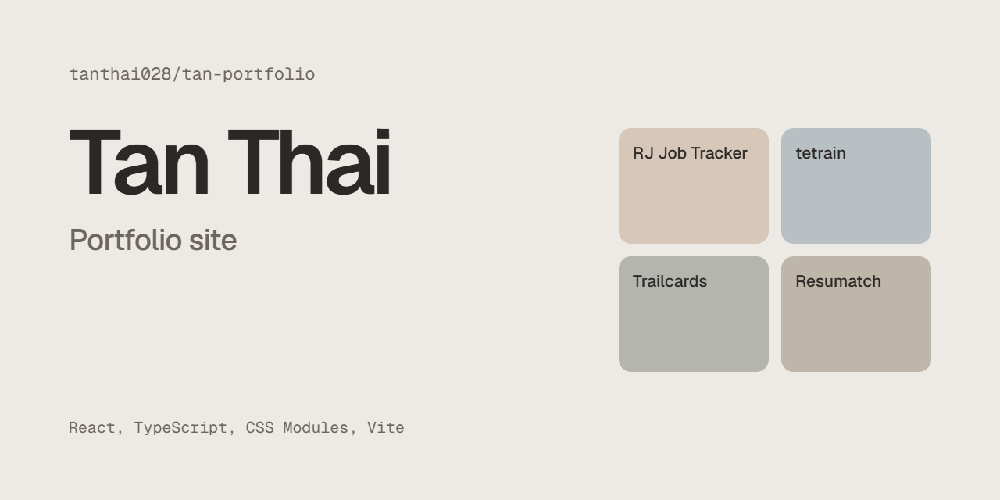

# tan-portfolio

My portfolio site: projects, experience, and résumé.

**Live:** [tan-portfolio-taupe.vercel.app](https://tan-portfolio-taupe.vercel.app)



React 19 and TypeScript with CSS Modules, built with Vite and hosted on Vercel. No UI library.

## How it was built

I built this with Claude Code, an AI coding agent. I set the requirements, reviewed each change on desktop and phone, and ran user tests from four points of view: a recruiter, a hiring manager, an engineer, and someone skeptical of AI-made work. Those tests drove most of the revisions, from the image viewer to removing copy that read as AI-generated. The site's footer has the same note.

## Run it

```bash
npm install
npm run dev
```

| Command | What it does |
| --- | --- |
| `npm run dev` | Local dev server |
| `npm run build` | Typecheck, then production build to `dist/` |
| `npm run lint` | oxlint |

Every push to `main` deploys to Vercel.

## Editing content

Text lives in typed data files, not in components.

| File | Holds |
| --- | --- |
| `src/data/profile.ts` | Name, intro line, availability, links, About text, skills |
| `src/data/projects.ts` | Project cards and the details in each project's pop-up |
| `src/data/experience.ts` | Jobs and education |
| `src/data/colophon.ts` | The "How I built this" note in the footer |

Types are in `src/types/content.ts`. Static files are in `public/`:

- `Tan_Thai_Resume.pdf` is the résumé download.
- `projects/*.webp` are project screenshots. A project's first image is its card cover, and every image shows in its pop-up, where it opens full size on click.
- `og.png` is the 1200×630 link preview.

Covers are laid out by shape, so a new screenshot needs only its `width` and `height` in the data file. Wide desktop shots fill the frame, while square popups and tall phone screens get narrower widths (`src/components/work/imageShape.ts`).

## Structure

```
src/
  components/
    layout/    Header, Footer, Section, ThemeToggle
    sections/  Hero, Work, About, Contact
    work/      ProjectCard, ProjectDialog, StatusBadge, imageShape
    ui/        Button, Dialog, Lightbox, InfoTip, Icon, Reveal, Tag, Toast
  data/        Site content
  hooks/       useTheme, useActiveSection, useCopyToClipboard
  styles/      tokens.css (design tokens), global.css (reset and base styles)
  types/       Content model
docs/          README and GitHub preview images
```

## Design notes

- **Tokens.** Colors, type, spacing, and motion are CSS custom properties in `src/styles/tokens.css`. Components only use semantic tokens like `--color-text`, so light and dark mode is one attribute on `<html>`.
- **Light by default, no flash.** An inline script in `index.html` applies a saved theme before the first paint. Switching themes cross-fades with the View Transitions API.
- **Nothing shifts the page.** Project and job details open in a native `<dialog>`, which becomes a bottom sheet on phones. Extra notes sit behind small `?` buttons using the Popover API. Screenshots open in a full-screen viewer sized to the screen, so tall phone shots are never cut off.
- **Deep links.** `/#project-<slug>` opens that project directly.
- **Cards are one click target with a real heading.** Each card's title is a `<button>` inside an `<h3>`, and its hit area is stretched over the whole card.
- **Link previews.** `index.html` uses `%SITE_URL%`, which a small Vite plugin fills at build time from `SITE_URL` or Vercel's `VERCEL_PROJECT_PRODUCTION_URL`.
- **Type.** Geist for text, Geist Mono for small labels, both self-hosted through Fontsource.
- **Motion.** Content fades in on scroll with `IntersectionObserver`. All motion is turned off under `prefers-reduced-motion`.
- **Analytics.** `@vercel/analytics` counts visits without cookies. Turn it on in the Vercel project's Analytics tab.
